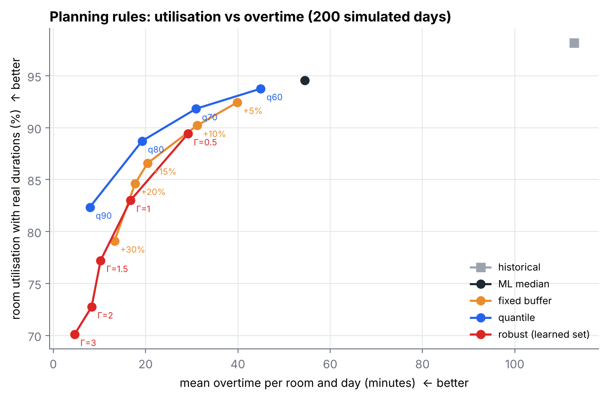

# From data to robust surgery schedules

**How uncertain is the duration of an operation, and what does learning that uncertainty change in an
operating-room schedule?** A small reproducible study on 6,385 surgeries from the open VitalDB dataset,
combining prediction intervals (conformal prediction) with a mixed-integer scheduling model.

**Read the [paper-style report (PDF)](report/report.pdf)** · browse the [notebook](notebooks/surgery_duration_uncertainty.ipynb)



## Results

| | |
|---|---|
| **Point prediction** | Gradient boosting on information available before surgery: MAE 45.6 ± 1.3 min vs 50.7 ± 1.8 for the per-procedure historical median (10 random splits). |
| **Calibrated uncertainty** | The usual per-procedure 10th–90th percentiles cover 76.5% of cases instead of 80%; raw quantile regression only 67.7%. Conformalized quantile regression (CQR) reaches 80.1% and has the best interval score, better than the historical interval in 10 of 10 splits. |
| **Context matters** | Coverage is not uniform: it drops for robotic surgery and small departments. Calibrating per department raises the worst department's coverage (0.74 → 0.76) but not the overall score. |
| **Schedules** | Planning on historical medians gives 113 min of overtime per room and day (80% of rooms overrun). Planning on each case's learned 80th percentile cuts this to 19 min while keeping 88.7% utilisation, 2.1 points more than a uniform +15% buffer at the same overtime. |
| **A negative result** | A budgeted robust model (Bertsimas & Sim) using the learned deviations was too conservative here: at equal overtime it loses about 10 points of utilisation against per-case quantiles. |

## Method in one picture

```
VitalDB (6,385 cases) ──► clean, encode, split by patient (train / calibration / test)
        │
        ├─► point models: global median, procedure history, gradient boosting
        ├─► intervals:    procedure percentiles, quantile GBM, split conformal, CQR, CQR per department
        │                 evaluated by coverage, width, interval score, coverage per context, 10 splits
        └─► schedules:    200 simulated days × 16 planning rules
                          set-packing MILP (HiGHS) → played with the real durations → overtime, utilisation
```

## Repository

```
src/data.py           download VitalDB, clean, encode, patient-grouped split
src/eda.py            duration distribution and within-procedure variability
src/models.py         point models, prediction intervals, coverage by context
src/run_repeats.py    the same evaluation on 10 random splits, paired comparisons
src/scheduling.py     pattern-based MILP for daily OR scheduling + simulation with real durations
src/fhir.py           export of cases as HL7 FHIR R4 Patient / Encounter / Procedure (sample in data/)
report/report.pdf     paper-style write-up
```

```bash
pip install -r requirements.txt
python run_all.py        # ~10 minutes on a laptop
```

## Data and limits

VitalDB (Lee et al., *Scientific Data* 9, 279, 2022; PhysioNet, CC BY 4.0): non-cardiac surgeries at Seoul
National University Hospital. It has no recovery-room (PACU) timestamps and no calendar dates, so this study
models operating-room time only and uses random patient-grouped splits instead of a time split. Results come
from one hospital and may not transfer to another.

Author: Deo Gratias Loutou, Master's student in computer science, Université de Haute-Alsace —
[portfolio](https://ldgkm.github.io) · [GitHub](https://github.com/LDGKM)
